## `> about`

I like understanding how things work under the hood. I started with Arduino to see code move something in the physical world, and I'm now building up web and software skills too.

**Stack:** `C++` · `Python` · `JavaScript` · `HTML/CSS` · `Arduino` · `Git`

## `> projects
<table> <tr> <td width="50%"></td> <td width="50%"></td> </tr> </table>

## `> connect`

[Portfolio](https://ind-soham.github.io/) · [LinkedIn](https://www.linkedin.com/in/dalvisoham/) · [Email](mailto:sohamdalvi59@gmail.com)
